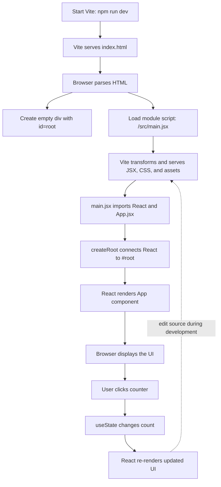

# React + Vite: How This App Loads and Renders

These notes explain the startup flow in this project, the role of `index.html`, `main.jsx`, React's `root`, and Vite, plus how the UI updates when you interact with it.

## The big picture



**Short version:** HTML provides the page shell; Vite serves and transforms the app files; `main.jsx` starts React; React renders `App` inside the HTML root element.

## 1. `index.html`: the page shell

See [index.html](index.html).

The browser first receives and parses the HTML page. The document includes metadata such as the page title, viewport settings, and favicon. The important parts for React are:

```html
<div id="root"></div>
<script type="module" src="/src/main.jsx"></script>
```

- `<div id="root"></div>` is initially empty. It is a regular HTML element—not a React component—and it does not fetch or render `App` on its own.
- The script tag tells the browser to load and execute the JavaScript module at `/src/main.jsx`.
- A module script is deferred by default, so the browser parses the HTML before executing the module.

Without the script, the page would contain an empty root element and React would never start.

## 2. Vite: development server and build tool

See [package.json](package.json) and [vite.config.js](vite.config.js).

The project defines these commands:

- `npm run dev` starts Vite's development server.
- `npm run build` creates production-ready output.
- `npm run preview` serves the production build locally for preview.
- `npm run lint` checks the project with ESLint.

During development, Vite serves `index.html` and the modules it references. It transforms JSX and handles imported CSS and assets so the browser can run the app. The React plugin is configured in `vite.config.js`. Vite also provides Hot Module Replacement (HMR), which can update changed modules in the browser without a full-page reload.

Vite does **not** render React components. React does that. Vite makes the project files available and prepares them for the browser.

## 3. `main.jsx`: the entry point and React bootstrap

See [src/main.jsx](src/main.jsx).

The entry file imports React's root API, the global stylesheet, and the app component. Its essential operation is:

```jsx
createRoot(document.getElementById('root')).render(
  <StrictMode>
    <App />
  </StrictMode>,
)
```

This does two things:

1. `document.getElementById('root')` finds the empty HTML container.
2. `createRoot(...).render(...)` tells React to render `<App />` into that container.

`StrictMode` is a development helper that can expose certain issues by running extra checks. It does not create the visible UI.

The roles are separate:

| Part | Role |
| --- | --- |
| `index.html` | Provides the page shell and root container |
| `main.jsx` | Imports the app and connects React to the container |
| React DOM (`createRoot`) | Mounts and updates React's UI in the browser DOM |
| `App.jsx` | Describes the application UI and its behavior |
| Vite | Serves/transforms modules during development and builds the app |

## 4. `App.jsx`: component, UI, and state

See [src/App.jsx](src/App.jsx).

`App` is a React function component. It returns JSX that describes the UI: the hero/logo area, heading, counter, documentation links, and community links.

The counter begins with:

```jsx
const [count, setCount] = useState(0)
```

- `count` is the current state value, initially `0`.
- `setCount` is the function React provides to request a state update.

The button uses this event handler:

```jsx
onClick={() => setCount((count) => count + 1)}
```

When clicked, the handler requests the next count. React calls the component again with the new state and updates the displayed `Count is ...` text. You normally do not manually edit the DOM; React updates it based on the component's returned JSX and current state.

The imported image assets and `App.css` are also used by this component. Vite processes these imports as part of the module graph.

## 5. CSS: how the rendered elements look

See [src/index.css](src/index.css) and [src/App.css](src/App.css).

- `index.css` contains global styles, theme variables, typography, and the layout of `#root`.
- `App.css` styles component-specific elements such as the hero, counter, documentation area, and responsive layout.
- CSS controls presentation; it does not create the React component tree.

## Follow one request from start to screen

For example, when visiting the app while `npm run dev` is running:

1. The browser requests the project page from Vite.
2. Vite returns `index.html`.
3. The browser creates the empty `#root` element and requests `/src/main.jsx` because of the module script.
4. Vite serves the entry module and its imports, transforming JSX and processing styles/assets as needed.
5. `main.jsx` imports `App` and calls `createRoot(...).render(...)`.
6. React evaluates `App`, creates the page UI, and places it inside `#root`.
7. Clicking the counter updates React state, causing React to render the new count.
8. Editing source files during development can trigger HMR through Vite.

## Mental model

Think of `#root` as an **empty stage**, `main.jsx` as the **setup that brings React onto the stage**, and `App` as the **description of what should appear there**. Vite is the **development/build system** that serves the files and prepares them for the browser. React is the library that renders and updates the UI.
