# React Learning Notes

A practical introduction to React, components, Vite, project structure, and the render flow. Examples use JavaScript and JSX, like this project.

## Contents

1. [What React is](#what-react-is)
2. [Why React](#why-react)
3. [Prerequisites](#prerequisites)
4. [Create and run a Vite + React app](#create-and-run-a-vite--react-app)
5. [Project structure](#project-structure)
6. [How the app loads and renders](#how-the-app-loads-and-renders)
7. [Components](#components)
8. [Organizing components into files](#organizing-components-into-files)
9. [JSX: HTML-like syntax inside JavaScript](#jsx-html-like-syntax-inside-javascript)
  - [Rules of JSX](#rules-of-jsx)
10. [Props and reusability](#props-and-reusability)
  - [Passing and reading props](#passing-and-reading-props)
  - [Passing different value types](#passing-different-value-types)
  - [Destructure props](#destructure-props)
  - [Default prop values](#default-prop-values)
  - [Forwarding props with spread and rest](#forwarding-props-with-spread-and-rest)
  - [Passing JSX as children](#passing-jsx-as-children)
11. [State and interaction](#state-and-interaction)
  - [Event handling](#event-handling)
    - [Passing event handlers as props](#passing-event-handlers-as-props)
12. [Conditional rendering](#conditional-rendering)
13. [Rendering lists](#rendering-lists)
  - [Why list keys matter](#why-list-keys-matter)
  - [Why index keys are risky](#why-index-keys-are-risky)
14. [Declarative UI and re-rendering](#declarative-ui-and-re-rendering)
15. [Composition](#composition)
16. [Styling and assets](#styling-and-assets)
  - [HTML `class` and JSX `className`](#html-class-and-jsx-classname)
  - [Regular CSS and CSS Modules](#regular-css-and-css-modules)
  - [JavaScript object property access](#javascript-object-property-access)
  - [Template literals and dynamic class names](#template-literals-and-dynamic-class-names)
  - [Props, children, and defaults in Alert](#props-children-and-defaults-in-alert)
  - [Complete CSS Module Alert](#complete-css-module-alert)
  - [CSS Modules versus inline styles](#css-modules-versus-inline-styles)
  - [Common styling mistakes and debugging](#common-styling-mistakes-and-debugging)
  - [Practice: exercises and mini-project](#practice-exercises-and-mini-project)
  - [Exercise solutions](#exercise-solutions)
17. [Useful commands](#useful-commands)
18. [Key takeaways](#key-takeaways)

## What React is

**React is a JavaScript library for building user interfaces.** It lets you describe a UI as components and update that UI when data changes. React is commonly used for web applications; React Native is a separate technology that uses React concepts to build native mobile apps.

React focuses on the UI rather than prescribing every part of an application. You can pair it with other tools—for example, a routing library for navigation or a data-fetching library for server data. A framework can provide more of those pieces together.

## Why React

- **Reusable UI:** Build a button, card, navigation bar, or page once and reuse it.
- **Component composition:** Build larger interfaces by combining smaller components.
- **Declarative updates:** Describe what the UI should show for current data; React updates the rendered interface when that data changes.
- **Ecosystem:** React has a broad collection of libraries, learning resources, and integrations.
- **Flexible integration:** React can be used in different application architectures rather than requiring every part of the stack to be React.

## Prerequisites

Before learning React, become comfortable with:

- **HTML:** elements, attributes, semantic structure, forms.
- **CSS:** selectors, layout (Flexbox/Grid), responsive styling.
- **Modern JavaScript:** `const`/`let`, functions, arrow functions, modules (`import`/`export`), arrays, objects, callbacks, and destructuring.
- **Basic browser concepts:** DOM, events, and the developer console.

JSX looks like HTML, but it is JavaScript syntax transformed by the build tooling. Some differences include `className` instead of `class`, and JavaScript expressions inside `{}`.

## Create and run a Vite + React app

You need Node.js and a code editor such as VS Code. From a terminal, run:

```sh
npm create vite@latest
```

Follow the prompts to choose a project name, the React framework, and a JavaScript variant. Then enter the new project folder and install its dependencies:

```sh
cd hello-world
npm install
npm run dev
```

Vite prints a local development URL, commonly `http://localhost:5173/`. Open that address in a browser. The exact port can differ if the default port is already in use.

To make a change, edit `src/App.jsx` and save. Vite's Hot Module Replacement (HMR) will usually update the page without a full reload.

## Project structure

This guide describes the layout of the current project. A newly generated project can vary slightly by Vite template and configuration.

```text
hello-world/
├── index.html           # HTML page shell; contains the React mount element
├── package.json         # Project metadata, scripts, dependencies
├── package-lock.json    # Locked dependency versions for npm installs
├── vite.config.js       # Vite and React-related configuration
├── eslint.config.js     # Linting rules
├── public/              # Static files served as-is
├── node_modules/        # Installed dependencies; regenerated by npm install
└── src/                 # Application source code
    ├── main.jsx         # JavaScript entry point; mounts React
    ├── App.jsx          # Main component and page UI
    ├── App.css          # Styles for the app's components
    ├── index.css        # Global styles and root layout
  ├── components/      # Reusable components in their own files
  │   ├── Button.jsx
  │   └── Welcome.jsx
    └── assets/          # Imported images and SVGs
```

### What the main files do

- **`package.json`:** Defines project scripts and lists dependencies. React and React DOM are runtime dependencies; Vite and lint tooling are development dependencies.
- **`index.html`:** The browser's HTML page shell. Its `#root` element is initially empty, and its module script loads `src/main.jsx`.
- **`src/main.jsx`:** The entry point. Imports global CSS and the app component, then attaches React to the root element.
- **`src/App.jsx`:** Defines the app UI as a React component.
- **`src/components/`:** Holds reusable UI components in separate modules. In this project, `App.jsx` imports `Button` and `Welcome` from here.
- **CSS files:** `index.css` holds global styles; `App.css` contains styles for app-specific elements.
- **`public/`:** For files referenced by URL and copied/served without being imported into JavaScript. For example, a file `public/logo.svg` can be referenced as `/logo.svg`.
- **`src/assets/`:** For assets imported by source modules. Vite includes and processes these imports as part of the build.
- **`node_modules/`:** Installed packages. Usually do not edit this folder or commit it.
- **Configuration files:** `vite.config.js` configures development/build behavior; `eslint.config.js` configures lint checks.

## How the app loads and renders

### Visual flow

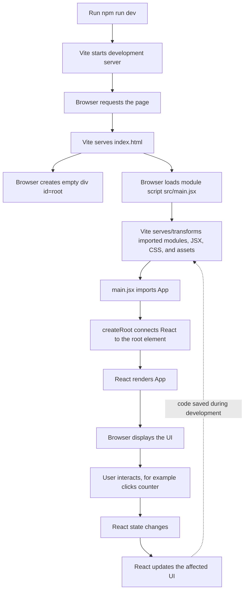

### The roles of each part

1. **Browser loads `index.html`.** It parses the page and creates `<div id="root"></div>`. This is a normal HTML element, not a React component. By itself, it does not load or render `App`.
2. **The script starts the JavaScript entry point.** `<script type="module" src="/src/main.jsx"></script>` asks the browser to load `main.jsx` as a JavaScript module.
3. **Vite serves and transforms modules.** During development, Vite serves the entry point and its imports. Its React integration supports JSX and development features such as HMR. Vite is not the library that renders React components.
4. **`main.jsx` mounts React.** It locates the `root` HTML element and calls React DOM's `createRoot(...).render(...)`.
5. **React renders `App`.** The component returns JSX, which React uses to create/update the visible interface inside `#root`.
6. **State updates cause UI updates.** For example, clicking the counter changes state and React renders the new count.

**Mental model:** `index.html` supplies an empty stage (`#root`); `main.jsx` sets up React on that stage; `App` describes what appears; Vite serves and prepares project files for the browser.

### Example: this project's entry point

In `src/main.jsx`, the central setup is:

```jsx
createRoot(document.getElementById('root')).render(
  <StrictMode>
    <App />
  </StrictMode>,
)
```

- `document.getElementById('root')` finds the HTML container.
- `createRoot(...)` creates a React root connected to that container.
- `.render(<App />)` asks React to render the app there.
- `<StrictMode>` enables additional development checks; it is not required to display the UI.

## Components

A **component** is a reusable unit of UI. It is usually a JavaScript function that returns JSX. It may include logic and can receive data through props or keep changing data in state.

```jsx
function Welcome() {
  return <h1>Welcome to React!</h1>
}

export default Welcome
```

Use a component in another component like a JSX element:

```jsx
function App() {
  return (
    <main>
      <Welcome />
    </main>
  )
}
```

### Component naming rules

- Component names start with a capital letter and use **PascalCase**, such as `WelcomeMessage` or `ProductCard`.
- The uppercase name tells JSX to treat `<WelcomeMessage />` as a JavaScript component. Lowercase names such as `<h1>` are treated as built-in HTML elements.
- A component must return one JSX expression. Use a parent element such as `<main>` or a fragment (`<>...</>`) to group sibling elements.

### Visual: component tree

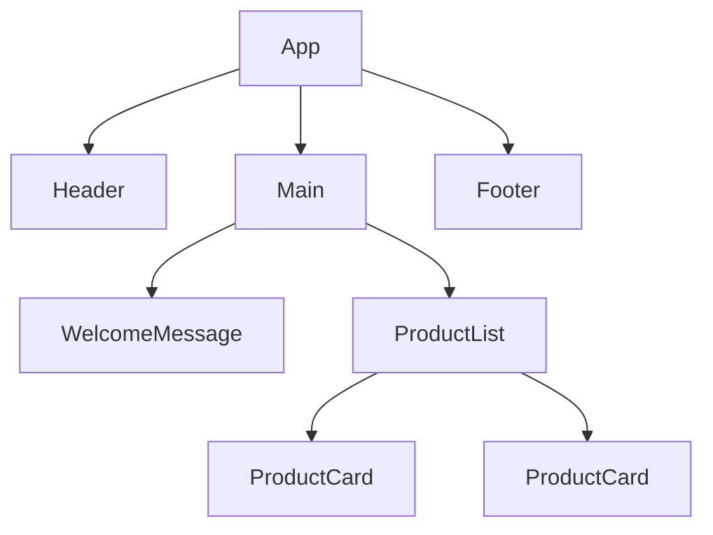

A component tree is not necessarily a file tree. One file can define several small components, though larger components are often split into separate files for clarity.

## Organizing components into files

As an app grows, move components into separate files so each component has a clear home. A component in another file must be **exported** by its source module and **imported** where it is used.

### Named exports and imports

This project uses named exports. For example, `src/components/Welcome.jsx` can export a component like this:

```jsx
export const Welcome = () => {
  return <div>Hi, learner!</div>
}
```

Then `src/App.jsx` imports that exact exported name using braces:

```jsx
import { Welcome } from './components/Welcome.jsx'

function App() {
  return <Welcome />
}
```

Named exports work well when a module exposes multiple values, and the import name matches the exported name (unless explicitly aliased). They make it easier to see which component is being used and can help avoid accidental renaming at the import site. The tutorial recommends named exports with arrow-function components; this is a style preference, not a React requirement. Function declarations are also valid components.

### Default exports and imports

A module may instead provide one default export:

```jsx
function Welcome() {
  return <div>Hi, learner!</div>
}

export default Welcome
```

The importing file does not use braces, and it chooses the local name:

```jsx
import WelcomeMessage from './components/Welcome.jsx'
```

Both forms are valid JavaScript modules and work with React. Pick a convention and use it consistently. Named exports make imports correspond to explicit exported names; default exports are convenient when a file has one primary value. Neither form is inherently required for React debugging.

| Export style | Export syntax | Import syntax |
| --- | --- | --- |
| Named | `export const Welcome = ...` | `import { Welcome } from './Welcome.jsx'` |
| Default | `export default Welcome` | `import Welcome from './Welcome.jsx'` |

### Why split components into modules?

- **Easier to find:** Component code has a predictable home, such as `src/components/Button.jsx`.
- **Easier to maintain:** A focused file is simpler to understand and update.
- **Reusable:** Multiple parent components can import the same component.
- **Clearer boundaries:** The app's main component can focus on arranging the page rather than defining every detail inline.

For this project, the component structure is:

```text
src/
├── App.jsx                   # imports and composes the page
└── components/
    ├── Button.jsx            # exports Button
    └── Welcome.jsx           # exports Welcome
```

### Module flow visualization

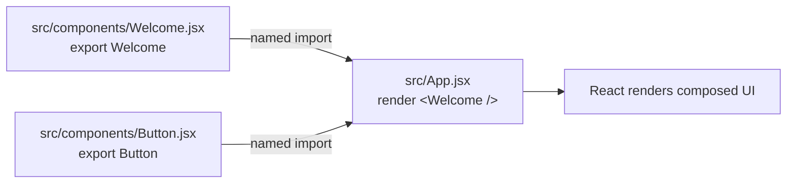

## JSX: HTML-like syntax inside JavaScript

**JSX (JavaScript XML)** is a syntax extension for JavaScript that lets you describe a UI with markup-like syntax inside a JavaScript file. It is commonly used with React because the component's structure and related JavaScript logic are easy to read together. JSX is not HTML pasted into JavaScript: it is syntax that development tools transform into regular JavaScript before the browser executes the app.

```jsx
const learnerName = 'Gautam'

export function Welcome() {
  return <h1 className="welcome">Hello, {learnerName}!</h1>
}
```

- `<h1>` describes an element in the UI.
- `className` is used instead of the HTML `class` attribute in JSX.
- `{learnerName}` inserts a JavaScript expression into the markup.
- JSX expressions can include values and calculations, for example `{2 + 2}`. Statements such as `if` are not placed directly inside braces; use a conditional expression or calculate a value before returning JSX.

### JSX compared with `createElement`

Before JSX, React elements could be described by calling `createElement` directly. The JSX and JavaScript below describe the same heading:

```jsx
// JSX: concise and visually resembles the resulting structure
const heading = <h1 className="welcome">Hello, {learnerName}!</h1>
```

```jsx
// Equivalent idea using React's createElement API
import { createElement } from 'react'

const heading = createElement(
  'h1',
  { className: 'welcome' },
  'Hello, ',
  learnerName,
  '!',
)
```

`createElement` takes the element type, its props, and its children. JSX is more convenient for deeply nested structures because the opening and closing tags make parent-child relationships visible at a glance.

### A nested example: a card

With JSX, a card's hierarchy is easy to scan:

```jsx
function ProfileCard() {
  return (
    <article className="profile-card">
      
      <div className="profile-card__body">
        <h2>Mina Chen</h2>
        <p>Learning to build with React.</p>
        <button type="button">View profile</button>
      </div>
    </article>
  )
}
```

The equivalent `createElement` calls have to be nested manually:

```jsx
import { createElement } from 'react'

function ProfileCard() {
  return createElement(
    'article',
    { className: 'profile-card' },
    createElement('img', { src: '/avatar.png', alt: 'Portrait of Mina' }),
    createElement(
      'div',
      { className: 'profile-card__body' },
      createElement('h2', null, 'Mina Chen'),
      createElement('p', null, 'Learning to build with React.'),
      createElement('button', { type: 'button' }, 'View profile'),
    ),
  )
}
```

Both approaches create a React element tree. The JSX version is usually easier to write and maintain as the UI grows; `createElement` remains useful to understand as the underlying element-creation idea and can still be called directly when needed.

### How JSX becomes runnable JavaScript

Browsers execute JavaScript, not JSX syntax. During development and builds, Vite's React tooling transforms JSX into JavaScript that uses React's element APIs. With the classic JSX transform, output is expressed using `React.createElement`; the modern automatic transform typically uses functions from React's JSX runtime instead. The precise generated code depends on the transform configuration, but the end result is a React element description that React can render.

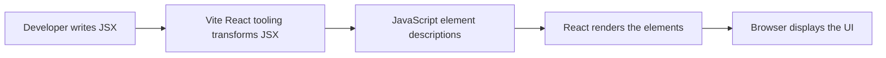

This transformation is sometimes described as **transpilation**: converting one form of source syntax into another form of JavaScript. JSX is often called syntactic sugar because it offers a clearer way to express the same element tree without writing every nested function call by hand.

### JSX quick rules

### Rules of JSX

JSX is not HTML; it is JavaScript syntax that looks like markup and is transformed by the build tools. Because JSX describes JavaScript values (React elements), it follows syntax rules that are stricter than writing ordinary HTML.

#### 1. Return one root element

A component's `return` must provide one JSX expression. You cannot return adjacent sibling tags without grouping them:

```jsx
// Invalid: these are two separate root elements
function Welcome() {
  return (
    <h1>Welcome!</h1>
    <p>Let’s learn React.</p>
  )
}
```

Wrap siblings in a parent element such as `<main>` or use a **Fragment**. A Fragment groups children without adding an extra element to the DOM:

```jsx
function Welcome() {
  return (
    <>
      <h1>Welcome!</h1>
      <p>Let’s learn React.</p>
    </>
  )
}
```

The short Fragment syntax `<>...</>` is convenient when no Fragment props are needed. React also provides `<Fragment>` for cases where a Fragment needs a `key`, such as when returning a list of grouped elements. Components can also intentionally return a single value such as `null`; the single-root guidance here is about grouping multiple JSX siblings in a return.

#### 2. Close every tag

JSX requires explicit closing tags. Elements with children need both opening and closing tags; elements with no children must be self-closing:

```jsx
function Profile() {
  return (
    <section>
      <h2>Mina Chen</h2>
      
      <input type="text" aria-label="Search profiles" />
    </section>
  )
}
```

For example, write ``, `<br />`, and `<input />`, not bare `` or `<br>`. This makes the element boundaries unambiguous to the JSX parser.

#### 3. Use React's JSX attribute names

JSX attributes generally use camelCase, and some HTML names are changed to avoid JavaScript naming conflicts:

| HTML attribute | JSX attribute | Example |
| --- | --- | --- |
| `class` | `className` | `<h1 className="title">Hello</h1>` |
| `for` | `htmlFor` | `<label htmlFor="email">Email</label>` |
| `tabindex` | `tabIndex` | `<button tabIndex={0}>Continue</button>` |
| `onclick` | `onClick` | `<button onClick={handleClick}>Save</button>` |

Follow React's DOM prop names and casing. `className` and `htmlFor` are particularly common because `class` and `for` have special meanings in JavaScript.

#### 4. Put JavaScript expressions inside braces

Use `{}` to insert a JavaScript **expression** into JSX. Expressions produce a value that React can display or use as an attribute:

```jsx
function Availability({ name, startingYear, isAvailable }) {
  return (
    <article>
      <h2>Hello, {name.toLowerCase()}!</h2>
      <p>Experience: {new Date().getFullYear() - startingYear} years</p>
      <p>{isAvailable ? 'Available' : 'Unavailable'}</p>
      <button disabled={!isAvailable}>Contact</button>
    </article>
  )
}
```

Braces can contain variables (`{name}`), calculations (such as `{new Date().getFullYear() - startingYear}`), conditional expressions (the ternary operator), and function or method calls (`{name.toLowerCase()}`). JSX does not accept statements such as `if` or `for` directly inside `{}`. For conditional output, use a ternary or `&&` expression, or calculate a value before the `return`:

```jsx
function Greeting({ isLoggedIn }) {
  const message = isLoggedIn ? 'Welcome back!' : 'Please sign in'

  return <h1>{message}</h1>
}
```

### JSX rules at a glance

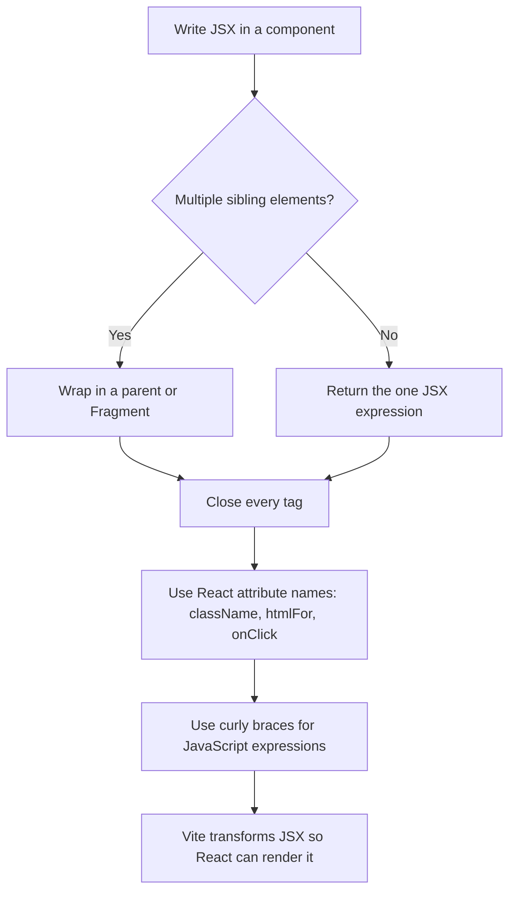

These rules make the markup-like syntax parseable as JavaScript and make the resulting element structure clear. For the transformation process, see [How JSX becomes runnable JavaScript](#how-jsx-becomes-runnable-javascript).

## Props and reusability

**Props** (short for properties) are inputs passed from a parent component to a child component. They let a component display different data while reusing the same UI structure. A useful mental model is to think of a React component as a JavaScript function and its props as the arguments supplied to that function.

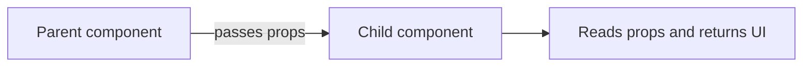

Props flow from parent to child. The child receives them as an object and should treat them as read-only; if a value needs to change, the parent can pass a new value (or a callback for the child to request an action).

### Passing and reading props

Pass props as attributes when writing a component tag. Every function component receives one props object as its parameter. You can access a property with dot notation:

```jsx
function Greeting(props) {
  return <p>Hello, {props.name}!</p>
}

function App() {
  return <Greeting name="Ari" />
}
```

Here, `App` is the parent. `<Greeting name="Ari" />` passes a `name` prop, so the child receives an object equivalent to `{ name: 'Ari' }` and displays “Hello, Ari!”.

A component can receive multiple props; each becomes a property on that same object:

```jsx
function Character(props) {
  return (
    <article>
      <h2>{props.name}</h2>
      <p>Also known as {props.alias}</p>
    </article>
  )
}

function App() {
  return <Character name="Peter Parker" alias="Spider-Man" />
}
```

### Passing different value types

String values can be written in quotes. Use curly braces to pass JavaScript values such as numbers, booleans, arrays, objects, or functions:

```jsx
function ProductCard(props) {
  return (
    <article>
      <h2>{props.title}</h2>
      <p>Price: ${props.price}</p>
      <p>{props.inStock ? 'In stock' : 'Sold out'}</p>
      <p>Tags: {props.tags.join(', ')}</p>
      <button type="button" onClick={props.onAddToCart} disabled={!props.inStock}>
        Add to cart
      </button>
    </article>
  )
}

function App() {
  const productTags = ['portable', 'work']

  function addLaptopToCart() {
    console.log('Laptop added to cart')
  }

  return (
    <ProductCard
      title="Laptop"
      price={1299.99}
      inStock={true}
      tags={productTags}
      onAddToCart={addLaptopToCart}
    />
  )
}
```

Notes:

- `title="Laptop"` passes a string.
- `price={1299.99}` passes a number; without braces, it would be the string `"1299.99"`.
- `inStock={true}` passes a boolean. A shorthand prop such as `<ProductCard inStock />` also means `true`.
- `tags={productTags}` passes an array, and `onAddToCart={addLaptopToCart}` passes a function. Curly braces contain JavaScript expressions; they do not mean that the value must be an object.
- A callback prop lets a child notify or request an action from its parent. Passing the function does not run it immediately; the child calls it in response to an event.

### Destructure props

Writing `props.propertyName` repeatedly can become noisy. JavaScript destructuring extracts the properties a component needs, usually right in its parameter list:

```jsx
function ProductCard({ title, price, inStock, tags, onAddToCart }) {
  return (
    <article>
      <h2>{title}</h2>
      <p>Price: ${price}</p>
      <p>{inStock ? 'In stock' : 'Sold out'}</p>
      <p>Tags: {tags.join(', ')}</p>
      <button type="button" onClick={onAddToCart} disabled={!inStock}>
        Add to cart
      </button>
    </article>
  )
}

function App() {
  return <ProductCard title="Laptop" price={1299.99} inStock tags={['portable', 'work']} onAddToCart={() => console.log('Added')} />
}
```

In `ProductCard({ title, price, ... })`, destructuring makes the expected props visible and allows using `title` rather than `props.title`. You can also assign a fallback value with a default parameter, for example `function Greeting({ name = 'learner' }) { ... }`; the fallback is used if `name` is missing or `undefined`.

Components can still be reused with different props:

```jsx
function Greeting({ name }) {
  return <p>Hello, {name}!</p>
}

function App() {
  return (
    <>
      <Greeting name="Ari" />
      <Greeting name="Sam" />
    </>
  )
}
```

Both instances use the same component structure but receive different values. This is the foundation of reusable, data-driven UI. Props are read-only from the receiving component's perspective: do not assign to or mutate props inside the child.

### Default prop values

Set a fallback directly in the destructured function parameter. React uses this value when the prop is omitted or its value is `undefined`:

```jsx
export function Greeting({ name = 'Guest', message = 'Hello' }) {
  return <p>{message}, {name}!</p>
}

function App() {
  return (
    <>
      <Greeting />
      <Greeting name="Ari" message="Welcome" />
      <Greeting name={undefined} />
    </>
  )
}
```

The first and third greetings use the defaults. A default is **not** used when a prop is explicitly `null`, `0`, `false`, or an empty string; those are supplied values, not `undefined`.

### Forwarding props with spread and rest

The **spread operator** (`...`) can pass every property in an object as props. This is useful for wrapper components that should forward options to an underlying element or component:

```jsx
function TextInput(props) {
  return <input className="text-input" {...props} />
}

function App() {
  return <TextInput type="email" placeholder="you@example.com" required />
}
```

Here the caller's input attributes are forwarded to the native `<input>`. The order matters when a property appears more than once: later values override earlier ones. For example, `<input {...props} className="text-input" />` always uses the wrapper's `className`, while `<input className="text-input" {...props} />` allows a `className` in `props` to override it. Forward only props that are appropriate for the target element or component.

The **rest operator** in destructuring gathers remaining properties after selected props are extracted. This lets a wrapper use its own props and pass the rest along:

```jsx
function LabeledInput({ label, id, ...inputProps }) {
  return (
    <label htmlFor={id}>
      {label}
      <input id={id} {...inputProps} />
    </label>
  )
}

function App() {
  return <LabeledInput label="Email" id="email" type="email" required />
}
```

`label` and `id` are used by `LabeledInput`; `type` and `required` are collected in `inputProps` and forwarded to `<input>`. Spread and rest use the same `...` syntax, but their roles differ: **spread expands** properties into a new object or JSX element, while **rest collects** remaining properties into a new object.

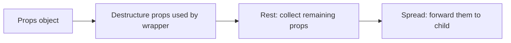

### Passing JSX as children

When a component is written with opening and closing tags, the content between them is received through the special `children` prop. This is a flexible pattern for cards, dialogs, and layout wrappers because the wrapper does not need to know the exact content it displays.

```jsx
function Card({ title, children }) {
  return (
    <section className="card">
      <h2>{title}</h2>
      <div className="card-content">{children}</div>
    </section>
  )
}

function App() {
  return (
    <Card title="Welcome">
      <p>This JSX is passed to Card as its children prop.</p>
      <button type="button">Get started</button>
    </Card>
  )
}
```

The `<p>` and `<button>` are not special to `Card`; it simply renders `{children}` where the nested content should appear. `children` may be a single element, several elements, text, or another component. A self-closing component can omit children, so wrappers should handle that possibility if it is meaningful for the UI.

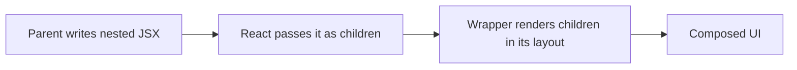

## State and interaction

**State** is data that belongs to a component and can change over time. Use React's `useState` Hook for simple local state.

```jsx
import { useState } from 'react'

function Counter() {
  const [count, setCount] = useState(0)

  function increment() {
    setCount((currentCount) => currentCount + 1)
  }

  return (
    <button type="button" onClick={increment}>
      Count is {count}
    </button>
  )
}
```

- `useState(0)` initializes `count` to `0`.
- `setCount` requests a state update.
- `onClick={increment}` registers the event handler. The function is passed to React; it is not called immediately during rendering.
- `setCount((currentCount) => currentCount + 1)` uses the previous state to compute the next state safely.

When state changes, React calls the component again and updates the UI to match its returned JSX. Do not change state variables directly; use the setter function.

### Event handling

**Definition.** An event is something that happens in the interface, such as a click, a form submission, or a value changing in an input. Event handling connects that occurrence to JavaScript logic. In React, you define a function and pass it to an event prop such as `onClick`.

**Why it exists.** Without event handlers, a rendered interface is mostly static. Handlers let a component respond to user actions, call other functions, update state, and communicate with parent components.

#### The two-step pattern

1. **Define** a handler function containing the work to do.
2. **Pass its reference** to the JSX event prop.

```jsx
function SaveButton() {
  function handleClick() {
    console.log("Save was clicked");
  }

  return <button onClick={handleClick}>Save</button>;
}
```

React event props use camelCase: `onClick`, `onChange`, `onSubmit`, and `onMouseEnter`. The handler itself is an ordinary JavaScript function; a common naming convention is `handle` followed by the event or action, such as `handleClick` or `handleSubmit`.

```text
User clicks button
        |
        v
React invokes the function registered in onClick
        |
        v
handleClick runs its statements
        |
        v
Optional state update -> React renders the updated UI
```

#### Pass a function, do not call it during rendering

In JSX, braces mean “evaluate this JavaScript expression.” A function name without parentheses refers to the function; adding parentheses calls it immediately.

```jsx
// Correct: give React the function to call later when a click happens.
<button onClick={handleClick}>Save</button>

// Incorrect for a normal event handler: calls handleClick while rendering.
<button onClick={handleClick()}>Save</button>
```

```text
onClick={handleClick}
  render: store the handler reference
  click:  React calls the handler

onClick={handleClick()}
  render: call the function now
  result: assign its return value to onClick
```

If a handler needs arguments, use a wrapper function so the call happens in response to the event:

```jsx
function GreetingButton({ name }) {
  function handleGreet() {
    console.log(`Hello, ${name}!`);
  }

  return <button onClick={handleGreet}>Greet</button>;
}
```

Or use an inline arrow function for a tiny action:

```jsx
<button onClick={() => console.log(`Hello, ${name}!`)}>
  Greet
</button>
```

Separate named functions can make substantial logic easier to read, reuse, and test. Inline arrow functions are useful for short one-off logic, especially when passing arguments. Avoid choosing one style as an absolute rule; keep the component understandable.

#### The event object

React passes an event object to the handler when the event occurs. In modern React, including React 19, event props provide React's event object (a `SyntheticEvent` for most event types), which exposes a consistent interface for interaction details and the involved DOM elements. Name it `event`, `e`, or another clear name.

```jsx
function ClickDetails() {
  function handleClick(event) {
    console.log("Clicked element:", event.target);
    console.log("Coordinates:", event.clientX, event.clientY);
    console.log("Mouse button:", event.button);
  }

  return <button onClick={handleClick}>Click for details</button>;
}
```

| Property | Meaning |
| --- | --- |
| `event.target` | The deepest DOM element where the event originated; it may be a nested child |
| `event.currentTarget` | The DOM element whose handler is currently running |
| `event.clientX` / `event.clientY` | Pointer coordinates relative to the browser viewport |
| `event.button` | Which mouse button initiated a mouse event; `0` commonly represents the primary/left button |
| `event.type` | The event type, such as `"click"` |

For example, if a click handler is attached to a `<button>` containing an `<span>`, and the user clicks the span, `event.target` can be the span while `event.currentTarget` is the button. Use `currentTarget` when you mean the element that owns the handler.

`clientX` and `clientY` are viewport coordinates, not coordinates relative to the whole document. For touch, keyboard, or other pointer interactions, the available event details differ; use the appropriate event props and browser APIs for that interaction.

```text
<button onClick={handleClick}>
  <span>Click me</span>
</button>

User clicks the span
       |
       +--> event.target        = <span>
       |
       +--> event.currentTarget = <button>
```

#### Handlers can read props and local component values

A handler is defined inside the component function, so it can use values in that component's scope, including props and local variables. This is ordinary JavaScript lexical scope (a closure); React does not need those values passed through the event object.

```jsx
function ActionButton({ userName, action }) {
  function handleClick(event) {
    console.log(`${userName} chose to ${action}`);
    console.log("Button:", event.currentTarget.textContent);
  }

  return (
    <button type="button" onClick={handleClick}>
      {action}
    </button>
  );
}

function App() {
  return <ActionButton userName="Ari" action="continue" />;
}
```

Execution trace:

```text
App passes userName="Ari" and action="continue"
                      |
                      v
ActionButton receives props and defines handleClick
                      |
                      v
React attaches handleClick to the button's onClick prop
                      |
              user clicks button
                      |
                      v
handleClick receives the event object and reads its closure values
                      |
                      v
Console: "Ari chose to continue"
```

The event object and component props are separate sources of information: `event` describes the interaction; `userName` and `action` are values supplied to the component.

#### Passing event handlers as props

**Definition.** A parent component can pass a function to a child as a prop. The child calls that function when an interaction happens. This lets the parent decide what the action means while the child focuses on rendering and reporting the interaction.

**Why this pattern matters.** A reusable child should not need to know application-specific behavior. A button can display text and call a supplied handler; one parent can use it to send a message, while another uses it to subscribe to a newsletter. This keeps UI components modular and lets parent components own business logic and state.

```text
Parent defines the action
        |
        | passes function as a prop
        v
Child receives callback prop
        |
        | user interacts with child
        v
Child invokes callback
        |
        v
Parent's function runs
```

##### Reusable button with parent-defined behavior

The child component accepts a label and an `onClick` function. It does not decide what a click should do:

```jsx
function ActionButton({ text, onClick }) {
  return (
    <button type="button" onClick={onClick}>
      {text}
    </button>
  );
}
```

Two different parents can supply two different actions while reusing exactly the same button:

```jsx
function Contact() {
  function handleSendMessage() {
    alert("Your message is ready to send.");
  }

  return (
    <ActionButton
      text="Send message"
      onClick={handleSendMessage}
    />
  );
}

function Newsletter() {
  function handleSubscribe() {
    alert("You are subscribed.");
  }

  return (
    <ActionButton
      text="Subscribe"
      onClick={handleSubscribe}
    />
  );
}
```

In JSX, `onClick={handleSendMessage}` passes the function reference through the child's `onClick` prop. Inside `ActionButton`, `onClick={onClick}` attaches that received function to the native button. React calls it only after the button is clicked.

```text
Contact                              ActionButton
handleSendMessage function  -------> onClick prop
                                      |
                                      v
                               <button onClick={onClick}>
                                      |
                               user clicks
                                      |
                                      v
                               handleSendMessage runs

Newsletter uses the same child but passes handleSubscribe instead.
```

**Expected behavior:** clicking **Send message** runs the message action; clicking **Subscribe** runs the subscription action. The child button stays the same.

##### Passing data from a child to the parent

The child can also pass information when it calls the callback. For example, a menu item can report its own name and price. The parent supplies `onOrder`; the child calls it with the selected item's data.

```jsx
function MenuItem({ name, price, onOrder }) {
  function handleClick() {
    onOrder(name, price);
  }

  return (
    <button type="button" onClick={handleClick}>
      Order {name} - ${price}
    </button>
  );
}
```

The parent defines what ordering means and receives the arguments:

```jsx
function Menu() {
  function handleOrder(name, price) {
    console.log(`Added ${name} to the order for $${price}.`);
  }

  return (
    <MenuItem
      name="Soup"
      price={6}
      onOrder={handleOrder}
    />
  );
}
```

The complete data flow is:

```text
Menu defines handleOrder(name, price)
                 |
                 | passes function as onOrder
                 v
MenuItem receives onOrder, name="Soup", price=6
                 |
            user clicks
                 v
MenuItem calls onOrder("Soup", 6)
                 |
                 v
Parent's handleOrder receives name="Soup", price=6
                 |
                 v
Parent performs its action (e.g., update cart or show details)
```

The callback prop is an ordinary function. Its name is up to the component API: names such as `onOrder`, `onSelect`, or `onSubscribe` communicate the event/action, while a parent handler name such as `handleOrder` communicates what the parent does.

An inline arrow function is also a common way to pass the item's values:

```jsx
function MenuItem({ name, price, onOrder }) {
  return (
    <button
      type="button"
      onClick={() => onOrder(name, price)}
    >
      Order {name}
    </button>
  );
}
```

The arrow function is important here: `onClick={onOrder(name, price)}` would call `onOrder` during rendering. With `onClick={() => onOrder(name, price)}`, React receives a function to call later, and that function then calls the callback with the arguments.

##### The event object and callback arguments

If the callback needs both the event and custom data, pass them deliberately:

```jsx
function MenuItem({ name, onOrder }) {
  return (
    <button
      type="button"
      onClick={(event) => onOrder(name, event)}
    >
      Order {name}
    </button>
  );
}
```

Do not assume a callback automatically receives custom props such as `name` or `price`. React supplies the event object when it calls the DOM event handler; the child decides which additional values to pass when invoking the parent callback.

**Common mistakes and fixes:**

| Mistake | Why it is wrong | Fix |
| --- | --- | --- |
| Child hard-codes the business action | The child becomes tied to one use case | Pass an action callback from the parent |
| Parent writes `onClick={handleOrder(name, price)}` | This invokes the parent handler while rendering | Pass a wrapper: `onClick={() => handleOrder(name, price)}` |
| Child renders `onClick` but does not forward it | The provided callback is never attached or called | Use it on the button: `<button onClick={onClick}>` |
| Child calls `onOrder()` without needed data | The parent receives no selected item details | Invoke `onOrder(name, price)` |
| Child calls the callback while rendering | Parent action runs on every render | Call it inside an event handler or event arrow function |
| Child expects the parent to know its internal variables | Values remain inside the child's scope | Pass the values as callback arguments |

**Real-world use cases:** reusable buttons, selecting a product, adding an item to a cart, choosing a menu option, dismissing a dialog, and notifying a parent that a form is ready to submit.

**Interview questions and answers:**

1. **How does a child notify a parent about a click?** The parent passes a function prop; the child invokes that callback from its event handler.
2. **Why not put all behavior inside the reusable child?** Keeping application-specific behavior in the parent lets the child be reused in different contexts.
3. **How can the child send data back?** Invoke the callback with arguments, such as `onOrder(name, price)`.
4. **Why use `onClick={() => onOrder(name, price)}`?** It creates a function for React to call later; it avoids executing `onOrder` during rendering.
5. **Does React automatically pass a child's props to the callback?** No. The child must explicitly pass any custom values as arguments.

#### Events and state updates

Event handlers commonly update state. The setter asks React to render again using the new state; do not directly mutate the state variable.

```jsx
import { useState } from "react";

function Counter() {
  const [count, setCount] = useState(0);

  function handleClick() {
    setCount((currentCount) => currentCount + 1);
  }

  return (
    <button type="button" onClick={handleClick}>
      Count: {count}
    </button>
  );
}
```

```text
Initial render: count = 0 -> button says "Count: 0"
                         |
                      click
                         v
handleClick calls setCount(previous => previous + 1)
                         |
                         v
React renders with count = 1 -> button says "Count: 1"
```

The functional setter form is useful when the next value depends on the previous state, because React supplies the latest previous value to the updater.

#### Common mistakes and debugging

| Mistake | What happens | Fix |
| --- | --- | --- |
| `onclick` or `on-click` in JSX | The prop name uses the wrong casing/format | Use camelCase such as `onClick` |
| `onClick={handleClick()}` | The function runs during rendering instead of on click | Pass `onClick={handleClick}` |
| `onClick="handleClick"` | A string is not a function handler | Pass a function reference in braces |
| Handler expects an argument but is called immediately | The action happens on every render | Use `onClick={() => handleAction(value)}` |
| Reads `event.target` when a nested child was clicked | `target` may be the child rather than the handler element | Use `event.currentTarget` when appropriate |
| Changes a state variable directly | React is not notified through the state setter | Call the setter, such as `setCount(...)` |
| Uses `event.clientX` as page/document position | Client coordinates are viewport-relative | Choose the coordinate system that matches the requirement |

#### Event handling practice

Try the questions before reading the answers.

**Beginner**

1. Write a `handleClick` function and attach it to a button's click event.
2. Is `onClick={handleClick}` or `onClick={handleClick()}` the usual way to register a handler? Why?
3. What casing does React use for event props?
4. Which event property identifies the element where a click originated?
5. Which event property identifies the element whose handler is running?

**Intermediate**

1. Write a button handler that logs the event's `clientX` and `clientY`.
2. Given `function handleSave(id) { ... }`, show how to call it with `id` only after a click.
3. Explain why an event handler inside a component can read that component's `name` prop.
4. A button contains an icon and has an `onClick` handler. The icon is clicked. Why might `event.target` and `event.currentTarget` differ?
5. Update a counter using the previous value safely from a click handler.
6. A reusable child receives `onClick`. Show how it should attach that callback to its button.
7. A `MenuItem` has `name`, `price`, and `onOrder` props. Show how it can send the name and price to its parent only after a click.
8. In one sentence, explain why a parent passes an event handler to a reusable child.

**Beginner answers**

1. `function handleClick() { console.log("Clicked"); }` and `<button onClick={handleClick}>Click</button>`.
2. `onClick={handleClick}` passes the function reference. Parentheses call it immediately during rendering.
3. camelCase, such as `onClick`, `onChange`, and `onSubmit`.
4. `event.target`.
5. `event.currentTarget`.

**Intermediate answers**

1. `function handleClick(event) { console.log(event.clientX, event.clientY); }` attached as `onClick={handleClick}`.
2. Use `<button onClick={() => handleSave(id)}>Save</button>`. The arrow function waits for the click and then calls `handleSave(id)`.
3. The function is declared inside the component and closes over its lexical scope, which includes the current props.
4. The target is the deepest element where the event started (the icon); the current target is the element where the registered handler is running (the button).
5. `setCount((previousCount) => previousCount + 1)`.
6. `function ActionButton({ onClick }) { return <button type="button" onClick={onClick}>Action</button>; }`.
7. Attach `onClick={() => onOrder(name, price)}` to the button. The arrow waits for the click and then invokes the parent callback with both values.
8. It keeps the child reusable and lets the parent decide the application-specific behavior.

## Conditional rendering

**Conditional rendering** means choosing which UI to show based on a condition, such as whether a user is signed in or whether data has loaded. Since JSX is written within JavaScript, use JavaScript control flow and expressions to decide what a component returns.

The examples below use a `UserDetails` component and a `user` prop:

### 1. Use `if` statements for complete alternatives

Use ordinary `if` statements before the component's main return when different conditions should produce substantially different UI. A component may return `null` to render nothing:

```jsx
function UserDetails({ user }) {
  if (!user) {
    return <p>No user is signed in.</p>
  }

  if (!user.isActive) {
    return null
  }

  return (
    <section>
      <h2>{user.name}</h2>
      <p>{user.email}</p>
    </section>
  )
}
```

The first matching `return` ends the component function. Returning `null` is a standard way to render no UI for that component.

### 2. Use a ternary for either-or output

The ternary operator (`condition ? valueIfTrue : valueIfFalse`) is useful for choosing one of two pieces of content, including directly inside JSX:

```jsx
function UserStatus({ user }) {
  return (
    <p>
      {user.isActive ? 'Active user' : 'Inactive user'}
    </p>
  )
}
```

Use a ternary when both outcomes matter. For complicated nested conditions, prefer `if` statements or a named variable to keep the JSX readable.

### 3. Use `&&` to show something only when true

The logical AND operator is useful when the false case should render nothing:

```jsx
function UserDetails({ user }) {
  return (
    <section>
      <h2>{user.name}</h2>
      {user.isAdmin && <p>Administrator</p>}
    </section>
  )
}
```

When `user.isAdmin` is true, React renders the paragraph; when false, the expression produces `false`, which React does not display.

**Number gotcha:** Avoid using a number directly as the left side of `&&` when it could be `0`. React renders the number `0`, so `items.length && <ItemList />` can display a stray zero when the list is empty. Compare explicitly instead:

```jsx
function ItemList({ items }) {
  return (
    <section>
      {items.length > 0 && <p>You have {items.length} items.</p>}
    </section>
  )
}
```

### 4. Use variables when the logic grows

When conditional content involves several branches, compute the UI before the main return. This keeps the main JSX focused on layout:

```jsx
function UserDetails({ user, isLoading, error }) {
  let content

  if (isLoading) {
    content = <p>Loading user…</p>
  } else if (error) {
    content = <p role="alert">Could not load the user.</p>
  } else if (user) {
    content = <p>Signed in as {user.name}.</p>
  } else {
    content = <p>Please sign in.</p>
  }

  return <section className="user-details">{content}</section>
}
```

The `content` variable can hold JSX, a string, or `null`. Keep the conditional logic close to the component that uses it, and prefer clear branches over dense nested ternaries.

### Choosing a conditional pattern

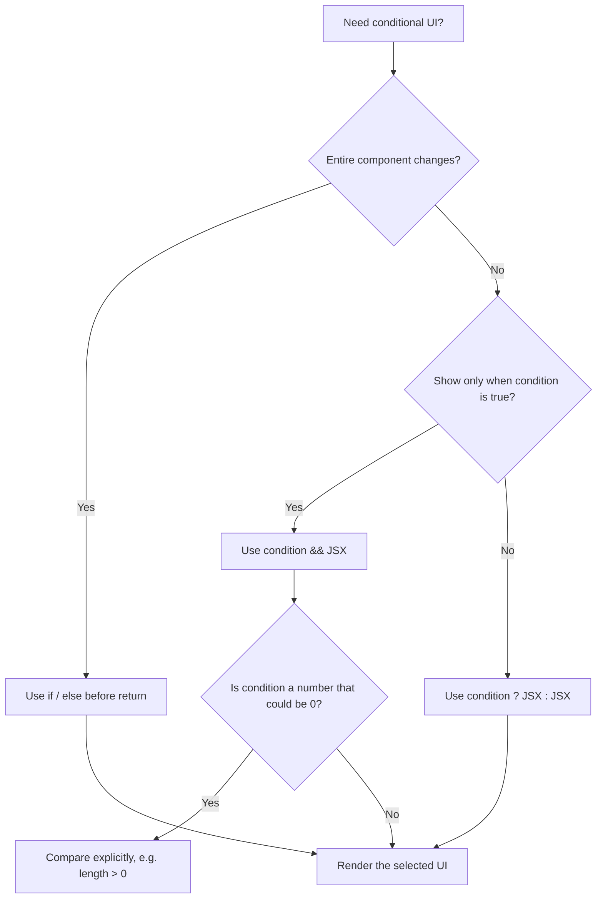

### Future topic: React `Activity`

React 19.2 introduced the `<Activity>` component. It can hide a UI section while preserving its state, then reveal it again later. This is different from returning `null`, which removes that component's rendered UI for the current render. `Activity` is an advanced feature; learn the basic conditional patterns first and consult the React documentation when you are ready to explore it.

## Rendering lists

Applications often display collections of data such as products, users, messages, or search results. Writing a separate JSX element for every item is repetitive and does not scale: every data change would require manually changing the component markup. Instead, keep the data in an array and use JavaScript's `.map()` method to turn each item into a React element.

### Start with an array of data

Represent each item as an object with named fields. Keeping content separate from the JSX makes it easy to add, remove, or update items without rewriting the component structure:

```jsx
const products = [
  { id: 'p-101', name: 'Desk lamp', price: 38, category: 'Home' },
  { id: 'p-102', name: 'Notebook', price: 12, category: 'Office' },
  { id: 'p-103', name: 'Travel mug', price: 24, category: 'Kitchen' },
]
```

If each product is hardcoded as a separate card, adding a fourth product means adding more JSX by hand. A data-driven list lets React render a card for every array item.

### Use `.map()` to create JSX elements

`.map()` calls a function for each array item and returns a new array containing the function's results. In React, that function can return JSX:

```jsx
function ProductList({ products }) {
  return (
    <ul>
      {products.map((product) => (
        <li key={product.id}>
          <h2>{product.name}</h2>
          <p>${product.price}</p>
          <p>{product.category}</p>
        </li>
      ))}
    </ul>
  )
}
```

For each product, the callback returns one `<li>`. The resulting array of list elements is rendered as the children of `<ul>`. When a product is added to the data array, the same mapping logic creates its UI; no new card markup is needed.

### Keep the mapping readable

Mapping directly inside JSX is concise and works well for a short transformation. If the rendering logic is longer, compute the mapped elements first and insert the result into the JSX:

```jsx
function ProductList({ products }) {
  const productItems = products.map((product) => (
    <li key={product.id}>
      <h2>{product.name}</h2>
      <p>${product.price}</p>
    </li>
  ))

  return <ul>{productItems}</ul>
}
```

Both forms do the same work. Choose the one that keeps the component easiest to read; use a named variable when it makes filtering, formatting, or branching clearer.

### Filter data before rendering

Use `.filter()` to select the items to display. It returns a new array containing only items that pass its test. You can chain `.filter()` and `.map()` to select products and then turn them into JSX:

```jsx
function PremiumProductList({ products }) {
  const premiumProducts = products.filter((product) => product.price >= 25)

  return (
    <ul>
      {premiumProducts.map((product) => (
        <li key={product.id}>
          {product.name} — ${product.price}
        </li>
      ))}
    </ul>
  )
}
```

The same transformation can be chained inline:

```jsx
{products
  .filter((product) => product.price >= 25)
  .map((product) => (
    <li key={product.id}>
      {product.name} — ${product.price}
    </li>
  ))}
```

For an empty result, consider showing a helpful message rather than leaving the list blank:

```jsx
function PremiumProductList({ products }) {
  const premiumProducts = products.filter((product) => product.price >= 25)

  if (premiumProducts.length === 0) {
    return <p>No premium products found.</p>
  }

  return (
    <ul>
      {premiumProducts.map((product) => (
        <li key={product.id}>{product.name}</li>
      ))}
    </ul>
  )
}
```

### Why list keys matter

Every element returned directly from a list mapping should have a **key** that is unique among its siblings. A key tells React which rendered item corresponds to which data item when a list is updated. React can then identify inserted, removed, or moved items and preserve the right component state. Without a key, React usually warns that each child in a list should have a unique key.

```jsx
products.map((product) => (
  <li key={product.id}>{product.name}</li>
))
```

#### Choose a unique, stable key

A key needs to be unique **within that list of siblings**; it does not need to be globally unique across the entire application. Prefer an ID already attached to the data, such as a database primary key:

```jsx
const products = [
  { id: 'p-101', name: 'Desk lamp' },
  { id: 'p-102', name: 'Notebook' },
]

function ProductList() {
  return (
    <ul>
      {products.map((product) => (
        <li key={product.id}>{product.name}</li>
      ))}
    </ul>
  )
}
```

For data created locally, assign an ID **when the item is created or received**, then keep that ID with the data. An incrementing counter or a UUID generator can be used when appropriate. Do not generate a fresh key while rendering, such as `key={Math.random()}` or `key={crypto.randomUUID()}` inside `.map()`: those values change on every render, so React treats the items as new each time.

#### Put the key on the outermost repeated element

The key belongs on the top-level element returned by the `.map()` callback. If a row renders multiple sibling elements, use an explicit keyed Fragment:

```jsx
import { Fragment } from 'react'

function ProductList({ products }) {
  return products.map((product) => (
    <Fragment key={product.id}>
      <h2>{product.name}</h2>
      <p>${product.price}</p>
    </Fragment>
  ))
}
```

The shorthand Fragment (`<>...</>`) cannot receive a key, so use `<Fragment key={...}>` when the Fragment itself is the repeated item. Putting a key only on a nested element does not identify the outer mapped item to React.

#### `key` is for React, not a regular prop

React uses `key` internally during reconciliation. A component cannot read it as `props.key`; pass the ID separately if the child needs it:

```jsx
products.map((product) => (
  <ProductCard key={product.id} productId={product.id} product={product} />
))
```

Here, `key` helps React track the list item, while `productId` is an ordinary prop that `ProductCard` can use.

#### Why index keys are risky

An array index describes an item's **current position**, not the identity of the data item. Using `key={index}` can seem to fix React's missing-key warning, but it can cause bugs whenever list positions change. If a list has no explicit keys, React also falls back to comparing children by their positions; explicitly using the index has much the same identity problem when items move.

Consider inserting a new item at the beginning:

```text
Before:  position 0 → Lamp (id: a)    position 1 → Mug (id: b)
After:   position 0 → Notebook (id: c) position 1 → Lamp (id: a) position 2 → Mug (id: b)
```

With index-based keys, position `0` used to represent Lamp but now represents Notebook; position `1` used to represent Mug but now represents Lamp. React may reuse the component instance and its state at each position for different data. This can make local input values, focus, animations, or other row state appear to jump to the wrong item.

#### Example: a to-do list with stateful inputs

Imagine each row has an input whose value is stored locally in the row component. An index key identifies the row by its position, so after sorting or inserting an item, React can preserve the state for a position even though a different to-do now occupies it:

```jsx
function TodoList({ todos }) {
  return (
    <ul>
      {todos.map((todo, index) => (
        <TodoRow key={index} todo={todo} />
      ))}
    </ul>
  )
}
```

If the first to-do is removed, the old second row becomes position `0`. React sees the same key (`0`) and may reuse that row's component state for the newly positioned to-do. The todo text may update while a locally held input value or other row state remains associated with the old position. Changing the key to `todo.id` makes identity follow the actual to-do:

```jsx
function TodoList({ todos }) {
  return (
    <ul>
      {todos.map((todo) => (
        <TodoRow key={todo.id} todo={todo} />
      ))}
    </ul>
  )
}
```

Now React can recognize a moved to-do as the same item and a newly inserted one as new, regardless of their positions.

#### When is an index key acceptable?

Prefer stable IDs. An index can be a last-resort key only when **all** of these are true:

1. The items have no suitable stable IDs.
2. The list is static: items are never inserted, removed, or reordered.
3. The list is never filtered, so each item's position cannot shift due to filtering.

If any of these assumptions might change, assign stable IDs when creating or receiving the data and retain them as the list changes. For example, a fixed list of constant labels could use indexes; an editable, sortable, filterable to-do list should use stable IDs.

| Key choice | Good fit? | Reason |
| --- | --- | --- |
| Stable data ID, e.g. `todo.id` | Recommended | Remains associated with the same item as order changes |
| ID assigned once when creating local data | Good | Stable if retained with the item |
| Array index | Only for a truly static, never-filtered list without IDs | Can identify the wrong item after positions change |
| `Math.random()` generated during render | Avoid | Changes each render, making every item appear new |

Keys help React reconcile lists correctly. They provide reliable item identity; they do not guarantee that every list render will be dramatically faster. When you see state appearing on the wrong row, input values or focus jumping, or glitchy row animations, check the list keys first.

### List rendering flow

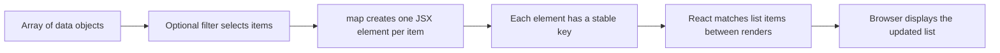

**Remember:** data array → optional `.filter()` → `.map()` to JSX → stable `key` on each mapped element.

## Declarative UI and re-rendering

With **declarative UI**, write what the screen should look like for the current values. React handles updating the DOM when props or state change.

```jsx
function Greeting({ loggedIn }) {
  return <h1>{loggedIn ? 'Welcome back!' : 'Please sign in'}</h1>
}
```

The component describes both possible outputs. If `loggedIn` changes, React renders the corresponding heading. In typical React code, you do not manually search for the heading and change its text with DOM APIs.

A simplified update flow is:

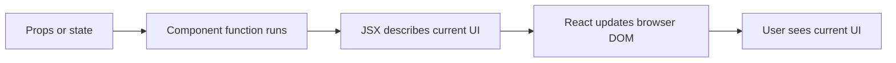

A re-render means React reevaluates a component to determine the UI for the new inputs. It does not mean the whole page is necessarily recreated from scratch.

## Composition

**Composition** means building a larger UI by nesting and combining components. It encourages components to have focused responsibilities.

```jsx
function Page() {
  return (
    <>
      <Header />
      <main>
        <Welcome />
        <Counter />
      </main>
      <Footer />
    </>
  )
}
```

`Page` composes smaller components into a complete page. The app's top-level component is often named `App`, but that name is a convention, not a React requirement.

## Styling and assets

React components describe structure and behavior; CSS describes presentation. A React component can connect to CSS using a class name, or provide a small set of styles through the `style` prop. Vite supports ordinary CSS imports and CSS Modules without extra configuration.

### HTML `class` and JSX `className`

**Definition.** A CSS class is a reusable label on an HTML element. A CSS selector such as `.primary-button` selects elements carrying the class name `primary-button`.

**Why JSX uses `className`.** In HTML, write `class="primary-button"`. In JSX, write `className="primary-button"`. JSX is JavaScript syntax, and `class` is a JavaScript keyword; React uses the DOM property name `className` to express the same idea clearly. React translates that JSX prop into the element's class attribute when it renders to the DOM.

| Context | Syntax | What it means |
| --- | --- | --- |
| HTML markup | `<button class="primary-button">Save</button>` | Put the `primary-button` class on the button |
| React JSX | `<button className="primary-button">Save</button>` | React renders a button with that class |
| CSS | `.primary-button { ... }` | Select elements whose class list contains `primary-button` |

**Small example and execution flow:**

```jsx
function Button() {
  return <button className="primary-button">Save</button>
}
```

```css
.primary-button {
  background-color: navy;
  color: white;
}
```

```text
Button() returns JSX
        |
        v
React renders <button className="primary-button">
        |
        v
DOM button receives class="primary-button"
        |
        v
Browser matches .primary-button and paints the button
```

The browser does not know that React was used. After rendering, it sees a normal DOM element and CSS class. If a component accepts a `className` prop, it can also pass that class through to its rendered element.

**Common mistake:** writing `class="..."` in JSX. Use `className`; otherwise JSX tooling may warn or the prop may not work as intended.

**Use case:** use classes for reusable, named visual rules such as buttons, cards, layouts, and alert variants.

**Interview check:** *How does a React `className` reach CSS?* React renders it as the DOM element's class attribute; the browser then matches the class against loaded CSS selectors.

### Regular CSS and CSS Modules

**Definition.** A regular CSS file contains ordinary selectors. A CSS Module is a CSS file conventionally named `Something.module.css`; the build tool transforms its class selectors into locally scoped names and gives JavaScript a mapping object.

**Why use CSS Modules?** Regular CSS classes share a global namespace. Two unrelated components can both declare `.error`, and both can be affected by either rule. CSS Modules avoid most accidental collisions by making class names local to the importing module.

| Feature | Regular CSS (`Alert.css`) | CSS Module (`Alert.module.css`) |
| --- | --- | --- |
| Import | `import "./Alert.css"` | `import styles from "./Alert.module.css"` |
| JSX class | `className="alert"` | `className={styles.alert}` |
| Naming behavior | Class name is global | Class name is mapped to a generated local name |
| Collision risk | Higher as an app grows | Lower; generated names are scoped to the module |
| Good fit | Resets, global typography, app-wide tokens | Component-specific styles |

With regular CSS, the selector and JSX class name must match:

```jsx
import "./Alert.css";

export function Alert() {
  return <div className="alert">Saved</div>;
}
```

```css
/* Alert.css */
.alert {
  padding: 16px;
  color: white;
}
```

This is valid and simple, but `.alert` exists in the global CSS namespace. A different component that uses `className="alert"` can receive the same rule.

With a CSS Module:

```jsx
import styles from "./Alert.module.css";

export function Alert() {
  return <div className={styles.alert}>Saved</div>;
}
```

```css
/* Alert.module.css */
.alert {
  padding: 16px;
  color: white;
}
```

**How the import works.** Vite recognizes the `.module.css` suffix. It processes the CSS and exposes a JavaScript object that maps each local class name to its generated class name. Conceptually, the source might behave like this:

```js
// Conceptual example only; the actual generated name is build-tool-specific.
const styles = {
  alert: "Alert_alert_a1b2c"
};
```

The CSS is transformed to use the corresponding generated name. The exact hash is not stable or something to type manually; Vite and its CSS tooling manage the mapping during development and production builds.

```text
Alert.jsx                         Alert.module.css
import styles                     .alert { ... }
     |                                  |
     +---------------+------------------+
                     v
               Vite transforms both
                     |
          +----------+-----------+
          v                      v
styles.alert -> "Alert_alert_x7k2"   CSS selector -> .Alert_alert_x7k2
          |                      |
          +----------+-----------+
                     v
       DOM class matches transformed CSS
```

**Important distinction:** `.alert` in the CSS file is a CSS selector. `styles.alert` in JavaScript is ordinary object-property access into the imported mapping. The spelling corresponds, but these are different languages and different roles.

**Expected rendered HTML:** the browser sees something similar to `<div class="Alert_alert_a1b2">Saved</div>`, not necessarily the original text `alert`. Development and production names may differ.

**Common mistakes and fixes:**

- Importing a module but writing `className="alert"`: use `className={styles.alert}` so the generated name is used.
- Importing regular CSS as if it were a module: use the `.module.css` naming convention when you need the mapping object.
- Expecting the generated name to be a particular hash: treat it as an implementation detail; refer to the class through `styles`.
- Forgetting that global CSS still exists: CSS Modules scope module class names, but do not make global styles, inherited styles, or every selector magically local. Keep truly global rules deliberate.

**Use cases:** CSS Modules work well for styles owned by a component, especially when components are developed independently or share common words such as `error`, `title`, and `container`.

**Interview check:** *What does `import styles from "./Alert.module.css"` provide?* A mapping from local CSS class names to generated class-name strings that the component uses in its rendered markup.

### JavaScript object property access

**Definition.** An object stores named properties. JavaScript can read a property with dot notation or bracket notation.

```js
const styles = {
  alert: "Alert_alert_k3m9",
  success: "Alert_success_k3m9",
  error: "Alert_error_k3m9"
};

styles.alert;       // "Alert_alert_k3m9"
styles["alert"];    // "Alert_alert_k3m9"
```

`styles.alert` is **dot notation**: the property name is written directly in the source code. `styles["alert"]` is **bracket notation**: the expression inside the brackets is evaluated to find the key. Both access the same property when the key is the literal string `"alert"`.

| Expression | Property key used | Static or dynamic? |
| --- | --- | --- |
| `styles.alert` | The literal key `alert` | Static |
| `styles["alert"]` | The literal string `"alert"` | Static |
| `styles[type]` | The current value stored in `type` | Dynamic |

**Why bracket access is needed for a variable.** Suppose `type` contains `"error"`. `styles[type]` evaluates `type` first and then reads `styles["error"]`. By contrast, `styles.type` always looks for a key literally named `"type"`; it does not look up the value of the variable.

```js
const type = "error";

console.log(styles[type]); // styles["error"] -> "Alert_error_k3m9"
console.log(styles.type);  // undefined: there is no "type" property
```

**Step-by-step flow:**

```text
type = "error"
       |
       v
Evaluate styles[type]
       |
       v
Use the value of type as the key: styles["error"]
       |
       v
Read the mapped class string for the error selector
```

**Common mistake:** writing `styles.type` when `type` is a variable. Change it to `styles[type]`. Use dot notation for a known, fixed key; use bracket notation when a variable or computed expression chooses the key.

**Use case:** dynamic lookup is useful for finite variants such as `success`, `error`, `warning`, or `info`. For values from users or an API, validate or constrain the value before assuming a matching CSS Module key exists.

**Interview check:** *What is the difference between `object.key` and `object[key]`?* The first reads the literal property named `key`; the second evaluates the variable/expression `key` and uses its result as the property name.

### Template literals and dynamic class names

**Definition.** A template literal is a string written between backticks. `${expression}` evaluates JavaScript and inserts its result into the string. Ordinary spaces inside the template literal remain spaces in the output.

```js
const name = "Mina";
const greeting = `Hello, ${name}!`; // "Hello, Mina!"
```

For a CSS Module, a template literal can combine a base class with a variant class:

```jsx
<div className={`${styles.alert} ${styles[type]}`}>
  Message
</div>
```

Break it into operations:

1. `styles.alert` reads the fixed base class, for example `"Alert_alert_k3m9"`.
2. `type` might contain `"error"`.
3. `styles[type]` then reads `styles["error"]`, for example `"Alert_error_k3m9"`.
4. The literal space between the two `${...}` expressions separates the class tokens.
5. The completed string is passed to React as the value of `className`.

```text
styles.alert         -> "Alert_alert_k3m9"
type                 -> "error"
styles[type]         -> "Alert_error_k3m9"
                         |
                         v
`${base} ${variant}` -> "Alert_alert_k3m9 Alert_error_k3m9"
                         |
                         v
<div class="Alert_alert_k3m9 Alert_error_k3m9">
```

An element can carry multiple classes. The browser matches both selectors. Here, the base class supplies padding, radius, margin, and text color; the variant class supplies its background color. Both sets of declarations apply to the same element. If both rules set the same property, the CSS cascade (including specificity and source order) determines the winner.

**Before and after:**

```jsx
// Only the base look; no variant background rule is selected.
<div className={styles.alert}>Message</div>

// Base look plus the selected variant look.
<div className={`${styles.alert} ${styles.error}`}>Message</div>
```

**Common mistake:** omitting the separating space:

```jsx
// Wrong: creates one combined class token that matches neither class.
className={`${styles.alert}${styles.error}`}

// Correct: preserves two class tokens.
className={`${styles.alert} ${styles.error}`}
```

**Use case:** template literals are convenient when class composition is short and understandable. For more complicated conditions, build the class string in a named variable or use the project's established class-composition helper if one exists.

**Interview check:** *Why is there a literal space in the template?* HTML class attributes contain a whitespace-separated list of class tokens; without the space, the browser sees one unrelated token instead of two.

### Props, children, and defaults in Alert

**Definition.** Props are values supplied by a parent to a component. `children` is the special prop containing content placed between a component's opening and closing JSX tags. Destructuring extracts named props from the props object.

```jsx
export const Alert = ({ children, type = "success" }) => {
  // ...
};
```

This function parameter means: take the component's props object, read `children`, read `type`, and use `"success"` as the default when `type` is `undefined`.

| Part | Meaning |
| --- | --- |
| `({ ... })` | Destructure the props object in the function parameter |
| `children` | Content nested inside `<Alert>...</Alert>` |
| `type` | A prop chosen by the parent to select the visual variant |
| `= "success"` | Default parameter value when `type` is omitted or explicitly `undefined` |

The parent writes:

```jsx
<Alert type="error">Something went wrong!</Alert>
```

Conceptually, the component receives an object like `{ type: "error", children: "Something went wrong!" }`. React calls the component with props; the function uses the selected type and returns JSX.

**Default-value detail:** `type = "success"` does not replace every falsy or invalid value. It applies when the value is `undefined`. For example, `type={null}` stays `null`; `type=""` stays an empty string. A string such as `"danger"` also remains `"danger"` even if no matching module class exists.

For the basic requested example, an unsupported value makes `styles[type]` undefined. JavaScript string interpolation turns that undefined value into the text `"undefined"`, so the resulting class string contains an `undefined` token. There is no matching CSS Module variant rule, so no variant background is applied; the base styling still applies. In production code, constrain allowed values and handle unsupported values intentionally rather than silently relying on this behavior.

**Execution trace for the three calls:**

```text
<Alert type="success">Data saved successfully!</Alert>
  props.type     = "success"
  props.children = "Data saved successfully!"
  selected class = styles["success"]

<Alert type="error">Something went wrong!</Alert>
  props.type     = "error"
  props.children = "Something went wrong!"
  selected class = styles["error"]

<Alert>Default success message</Alert>
  props.type     = undefined -> default "success"
  props.children = "Default success message"
  selected class = styles["success"]
```

**Use case:** use props to make one component reusable for messages with different content and appearance. Use defaults for the common case, but define and validate the supported variant set.

**Interview check:** *When does a destructured default apply?* When the corresponding prop is `undefined` (including omitted); it does not replace `null`, an empty string, or an unsupported string.

### Complete CSS Module Alert

The following is the central example. Place the component and its module side by side, for example as `Alert.jsx` and `Alert.module.css`.

```jsx
// Alert.jsx
import styles from "./Alert.module.css";

export const Alert = ({ children, type = "success" }) => {
  return (
    <div className={`${styles.alert} ${styles[type]}`}>
      {children}
    </div>
  );
};
```

```css
/* Alert.module.css */
.alert {
  padding: 16px;
  border-radius: 8px;
  margin-bottom: 16px;
  color: white;
}

.success {
  background-color: #10b981;
}

.error {
  background-color: #ef4444;
}
```

**Complete execution flow:**

```text
1. Vite sees the .module.css import and creates a local-name mapping.
                         |
2. Parent renders <Alert type="error">Something went wrong!</Alert>.
                         |
3. React supplies props: { type: "error", children: ... }.
                         |
4. Destructuring reads children and type.
                         |
5. Evaluate styles.alert and styles[type].
   Since type is "error", the second lookup is styles["error"].
                         |
6. Template literal joins both generated names with a space.
                         |
7. Alert returns a div with the message as its child.
                         |
8. React creates a DOM div with two CSS class tokens.
                         |
9. Browser applies shared .alert declarations and .error background.
```

Example usage:

```jsx
<Alert type="success">Data saved successfully!</Alert>

<Alert type="error">Something went wrong!</Alert>

<Alert>Default success message</Alert>
```

The rendered markup has generated module class names. Exact generated strings depend on the build configuration, but the structure is conceptually:

```html
<div class="Alert_alert_HASH Alert_success_HASH">Data saved successfully!</div>
<div class="Alert_alert_HASH Alert_error_HASH">Something went wrong!</div>
<div class="Alert_alert_HASH Alert_success_HASH">Default success message</div>
```

The repeated `HASH` labels above are illustrative placeholders, not literal output. `Alert` is the component; `alert` is its shared base style; `success` or `error` is the variant. CSS Modules convert local names while preserving that relationship.

**Before and after when adding the variant class:**

```text
Before: class="Alert_alert_HASH"
        padding, radius, margin, white text
        (no success/error background selected)

After:  class="Alert_alert_HASH Alert_error_HASH"
        shared base declarations + red error background
```

**Real-world use:** alerts, badges, buttons, tabs, and status labels often have shared base styling plus a small, known set of variants.

### CSS Modules versus inline styles

**Definition.** CSS Modules apply named CSS classes through `className`. Inline styles pass a JavaScript object directly through the React `style` prop.

```jsx
// CSS class
<div className={styles.alert}>Saved</div>

// Inline style
<div style={{ backgroundColor: "green", color: "white" }}>Saved</div>
```

The doubled braces in JSX have two jobs: the outer `{}` inserts a JavaScript expression into JSX; the inner `{}` is the JavaScript object value.

CSS property names in JavaScript style objects use camelCase: `backgroundColor`, not the CSS text spelling `background-color`. A hyphen is not valid in a bare JavaScript identifier, while camelCase corresponds to React's style-object property names. Most values are strings with units where needed, such as `{ marginTop: "12px" }`; some properties such as `opacity` accept numbers. React handles unit serialization according to its style rules.

| Consideration | CSS Modules (`className`) | Inline `style` prop |
| --- | --- | --- |
| Reuse | Reuse named rules across elements/components | Reuse requires a shared JS object/helper |
| Dynamic values | Select from classes/variants or CSS custom properties | Convenient for values computed at runtime |
| Pseudo-classes (`:hover`, `:focus`) | Supported in CSS | Not expressible as ordinary inline declarations |
| Media queries | Supported in CSS | Not expressible directly in a style object |
| Maintainability | Styles remain in CSS; good for larger rule sets | Can become noisy when many declarations are in JSX |
| Scope | Module class names are locally scoped | Applies directly to that rendered element |
| Best fit | Component visuals, states, responsive rules | A few truly data-driven values, e.g. a measured width |

**Dynamic styling examples:**

```jsx
// Choose between predefined, reusable CSS Module rules.
<div className={`${styles.alert} ${styles[type]}`}>Message</div>

// Provide a value that is genuinely computed at runtime.
<div style={{ width: `${progress}%` }}>Loading</div>
```

Inline style objects are not a replacement for all CSS. They cannot use selectors, pseudo-classes, or media queries directly, and they can mix presentation details into component logic. CSS Modules are usually the clearer choice for component styling; inline styles are useful when a value is computed dynamically and does not need a CSS rule or selector.

**Interview check:** *When would you use inline styles rather than a CSS Module?* When a small value is data-driven at runtime (such as a progress width) and does not require pseudo-classes, media queries, or a reusable selector.

### Common styling mistakes and debugging

| Symptom or mistake | Why it happens | Fix |
| --- | --- | --- |
| `class="alert"` in JSX | JSX uses React's DOM prop spelling | Use `className="alert"` or `className={styles.alert}` |
| `styles.type` selects nothing | Dot notation looks for the literal key `type` | Use `styles[type]` when `type` is a variable |
| Two classes become one token | No whitespace separates the strings | Use `` `${styles.alert} ${styles.error}` `` |
| A style is missing | The selector is not defined in the module or the wrong key is used | Check the spelling and add the missing `.class` rule |
| `styles.alert` is undefined | File may not be named/imported as a CSS Module, or the key differs | Check `.module.css`, import path, and exact selector name |
| Invalid variant has no color | There is no matching key such as `styles.danger` | Restrict variants or provide an explicit fallback |
| CSS `.alert` is confused with `styles.alert` | One is a selector, the other is an object property | The selector defines a rule; the mapping property supplies its generated class string |
| CSS Module class is placed in a string directly | The generated name is not the source class name | Reference the class through `styles` |

**A practical debugging sequence:**

1. Inspect the element in browser developer tools and confirm it has the expected class tokens.
2. Confirm the module import path and `.module.css` suffix.
3. Confirm the selector name matches the property key exactly (CSS class names are case-sensitive).
4. Confirm a space separates base and variant class strings.
5. Check whether the selected type is supported.
6. Inspect computed styles to see whether another rule overrides the expected declaration.

For robust code, make the supported variants explicit. This mini-project later demonstrates a fallback so invalid input cannot accidentally select an undefined module property.

### Practice: exercises and mini-project

Try these before opening the solutions in the next section.

#### Beginner exercises

1. Convert `<p class="note">Read this</p>` into JSX with the correct attribute.
2. Given `const styles = { title: "title_hash" }`, write two expressions that read the `title` property.
3. If `const type = "error"`, write the expression that reads the error class from `styles`.
4. Add two CSS Module classes, `styles.card` and `styles.selected`, to one `div` with the correct whitespace.
5. In one sentence, explain what `children` contains in `<Alert>Hello</Alert>`.

#### Intermediate exercises

1. Define the base `.alert` rule and `.success` / `.error` rules in a CSS Module.
2. Trace the `type` and `children` values for `<Alert>Saved</Alert>` when the component parameter is `({ children, type = "success" })`.
3. Explain what happens if `type="warning"` is passed to the basic two-variant component.
4. Rewrite `styles.type` so a variable called `type` selects the matching property.
5. Choose CSS Modules or inline styles for a button's `:hover` rule and for a progress bar whose width is a numeric value. Explain each choice.

#### Interview-style questions

1. Why does React JSX use `className` instead of HTML's `class`?
2. How do CSS Modules reduce class-name collisions, and what does the build tool do?
3. Explain the difference between `styles.type` and `styles[type]`.
4. How can an element receive styles from two CSS classes at once?
5. When does a destructured default such as `type = "success"` apply, and when does it not apply?

#### Mini-project: reusable four-variant Alert

Build `Alert.jsx` and `Alert.module.css` for `success`, `error`, `warning`, and `info` alerts. Requirements:

- All variants share padding, border radius, margin, and readable text.
- The component accepts `children` and an optional `type` defaulting to `"success"`.
- The selected variant is applied alongside the shared base class.
- An unsupported value falls back to success instead of creating an undefined class.
- Demonstrate one instance of each supported variant.

### Exercise solutions

#### Beginner exercise answers

1. `<p className="note">Read this</p>`.
2. `styles.title` and `styles["title"]`.
3. `styles[type]`. Since `type` is `"error"`, JavaScript reads `styles["error"]`.
4. `<div className={`${styles.card} ${styles.selected}`}>...</div>`. The space creates two class tokens.
5. `children` is the nested content between the component's opening and closing tags, here the text `"Hello"`.

#### Intermediate exercise answers

1. For example:

   ```css
   .alert {
     padding: 16px;
     border-radius: 8px;
     margin-bottom: 16px;
     color: white;
   }

   .success { background-color: #10b981; }
   .error { background-color: #ef4444; }
   ```

2. `children` is `"Saved"`; `type` is omitted, so it is `undefined` and the destructured default makes it `"success"`. The component reads `styles.success`.
3. The basic example tries to read `styles.warning`. If that key is missing, the lookup returns `undefined` and the class string contains an `"undefined"` token; no warning rule matches, so the base declarations apply without a warning background. Explicit fallback handling is safer.
4. Use `styles[type]`. `styles.type` looks for a property literally named `type`.
5. Use a CSS Module for `:hover`, since pseudo-classes are CSS selectors. Inline style is reasonable for a runtime-computed progress width, e.g. `style={{ width: `${progress}%` }}`.

#### Interview-style answer guide

1. `className` is React's JSX/DOM prop name; JSX uses JavaScript syntax and `class` is a JavaScript keyword.
2. The build tool transforms local selectors and provides a mapping from source keys to generated class strings, so separate modules are less likely to collide.
3. `styles.type` reads the literal `"type"` key; `styles[type]` evaluates the `type` variable and uses its value as the key.
4. Put both class strings in the element's class list, separated by whitespace. The browser matches both selectors and applies their declarations according to the cascade.
5. It applies only when the prop is omitted or `undefined`; `null`, `""`, and unsupported values are not replaced by that default.

#### Mini-project solution

```jsx
// Alert.jsx
import styles from "./Alert.module.css";

const supportedTypes = ["success", "error", "warning", "info"];

export const Alert = ({ children, type = "success" }) => {
  const variant = supportedTypes.includes(type) ? type : "success";

  return (
    <div className={`${styles.alert} ${styles[variant]}`}>
      {children}
    </div>
  );
};
```

```css
/* Alert.module.css */
.alert {
  padding: 16px;
  border-radius: 8px;
  margin-bottom: 16px;
  color: white;
}

.success { background-color: #10b981; }
.error { background-color: #ef4444; }
.warning { background-color: #f59e0b; }
.info { background-color: #3b82f6; }
```

```jsx
<Alert type="success">Saved successfully.</Alert>
<Alert type="error">The save failed.</Alert>
<Alert type="warning">Check the entered details.</Alert>
<Alert type="info">A new update is available.</Alert>
<Alert type="unknown">Uses the documented success fallback.</Alert>
```

The `supportedTypes` list constrains the lookup. `variant` is always one of the keys defined in the CSS Module, so `styles[variant]` resolves to a class string. A TypeScript project can express the allowed values as a union type for compile-time checking; in this JavaScript example, the runtime check handles unexpected inputs.

### Styling revision summary

- JSX uses `className`; HTML markup uses `class`.
- Regular CSS class names are global; `.module.css` class names are transformed and mapped locally by the build tool.
- `styles.alert` accesses the fixed `alert` key; `styles[type]` uses the current value of `type`.
- A template literal interpolates class strings; whitespace between them is what keeps them separate.
- The shared Alert class supplies common rules; the selected variant supplies its own background.
- `children` is nested content; `type = "success"` defaults only when `type` is `undefined`.
- Use CSS Modules for maintainable component rules and inline styles for a few runtime-computed style values.
- Validate variant values so unsupported input has an intentional fallback.

An image inside `src/assets` can be imported and used as a module value:

```jsx
import reactLogo from './assets/react.svg'

function Logo() {
  return 
}
```

Use meaningful alternative text (`alt`) for images that communicate information. Use `alt=""` for purely decorative images.

## Useful commands

Run these commands from the project directory:

| Command | Purpose |
| --- | --- |
| `npm install` | Install dependencies listed in the project manifest/lock file |
| `npm run dev` | Start Vite's development server |
| `npm run build` | Build production files, usually into `dist/` |
| `npm run preview` | Locally preview the production build |
| `npm run lint` | Run ESLint checks |

## Key takeaways

- React is a JavaScript UI library built around components.
- A component is commonly a capitalized JavaScript function that returns JSX.
- Props pass data into components; state represents changing data managed by a component.
- Declarative rendering means describing the desired UI and letting React update it when inputs change.
- `index.html` provides `#root`; `main.jsx` connects React to that element; `App.jsx` defines the UI.
- Vite serves/transforms files during development, supports HMR, and produces the production build. React is responsible for rendering the component UI.
- Components can be reused and composed to create complex pages.
- React event handlers are passed as function references in camelCase props such as `onClick`; handlers can read event data, props, and local values.
- Use CSS Modules for locally scoped component classes, and use inline styles selectively for values computed at runtime.
